# Slightly After Dark

A native macOS and Windows screen saver that runs [Bryan Braun](https://github.com/bryanbraun)'s
recreations of classic After Dark animations

## Gallery

These previews are rendered offscreen at 1024×768 and stepped deterministically
at 25 FPS; they are generated from the same bundled HTML and CSS as the screen
saver rather than from a display recording.

### Flying Toasters

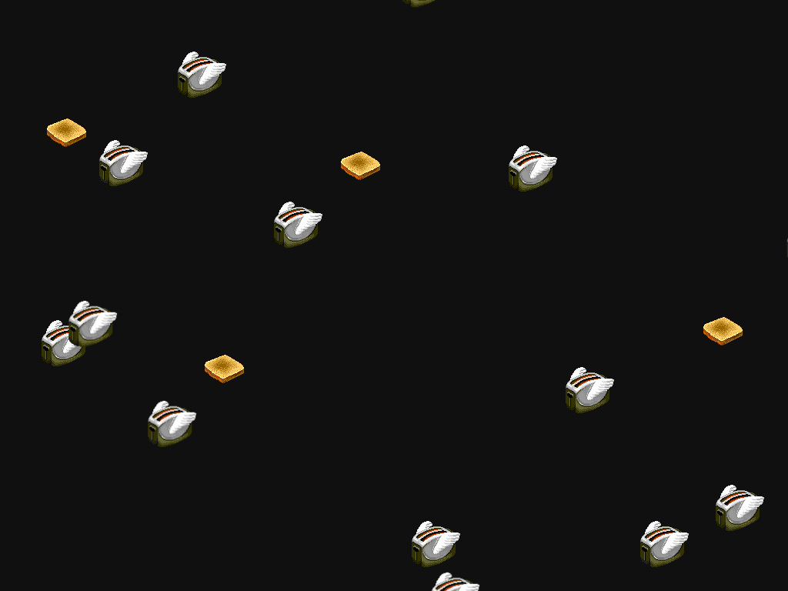

### Fish


### Globe

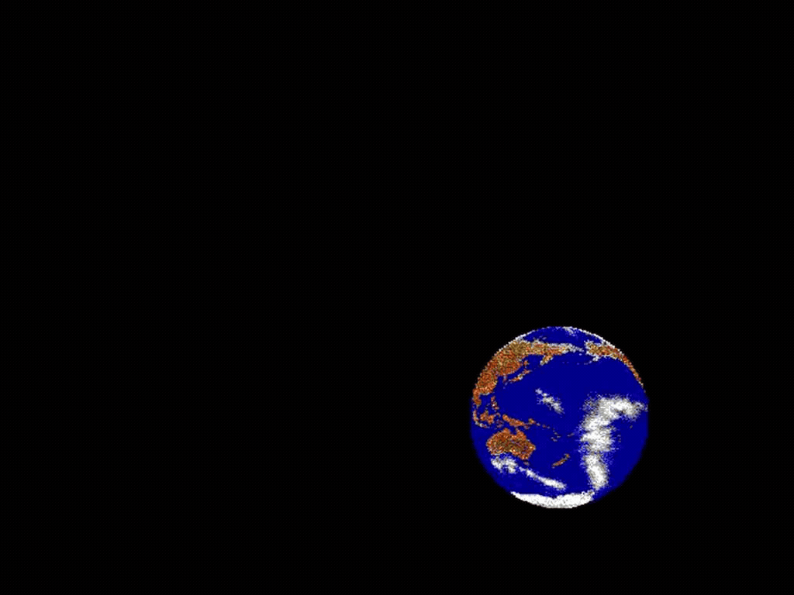

### Hard Rain

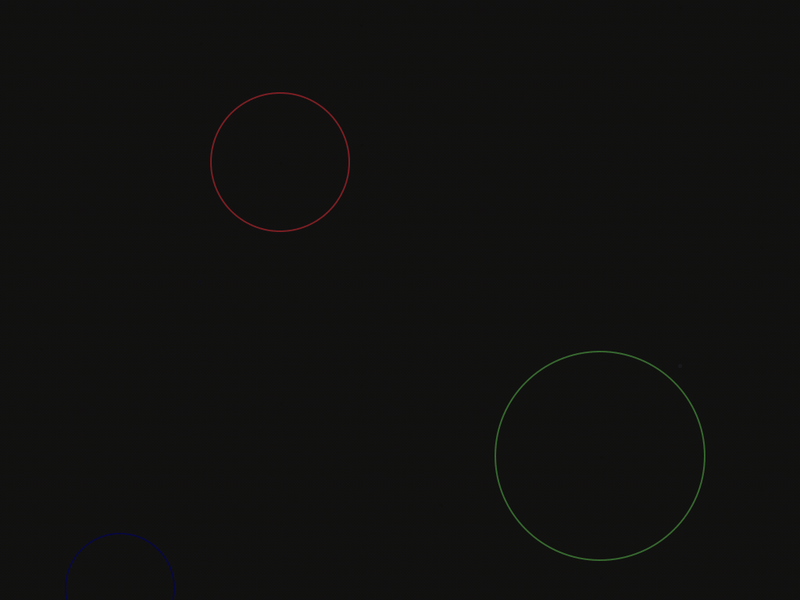

### Bouncing Ball

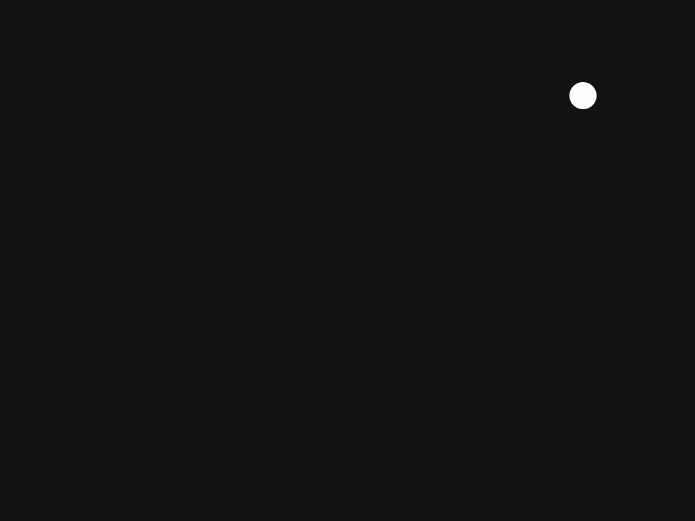

### Warp

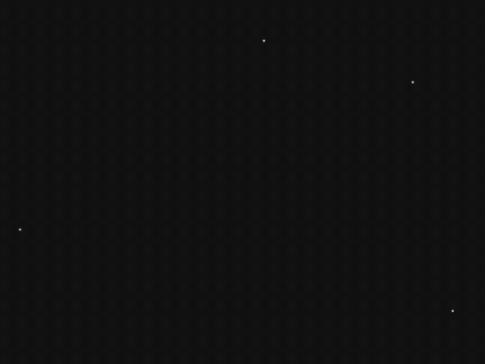

### Messages

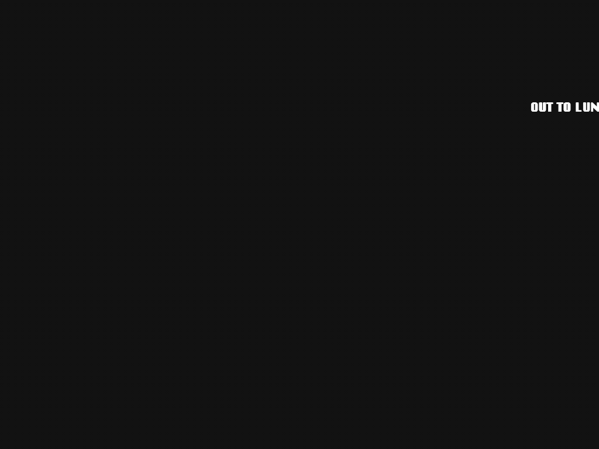

### Messages 2

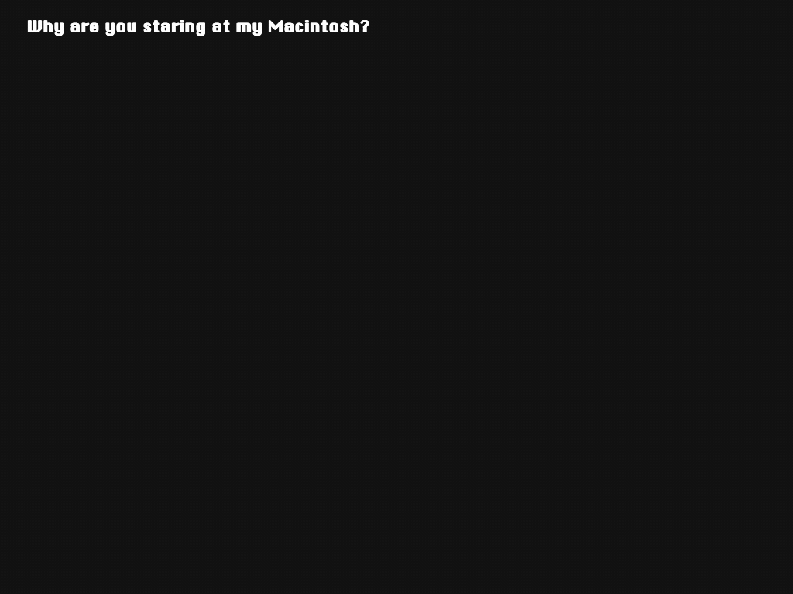

### Fade Out

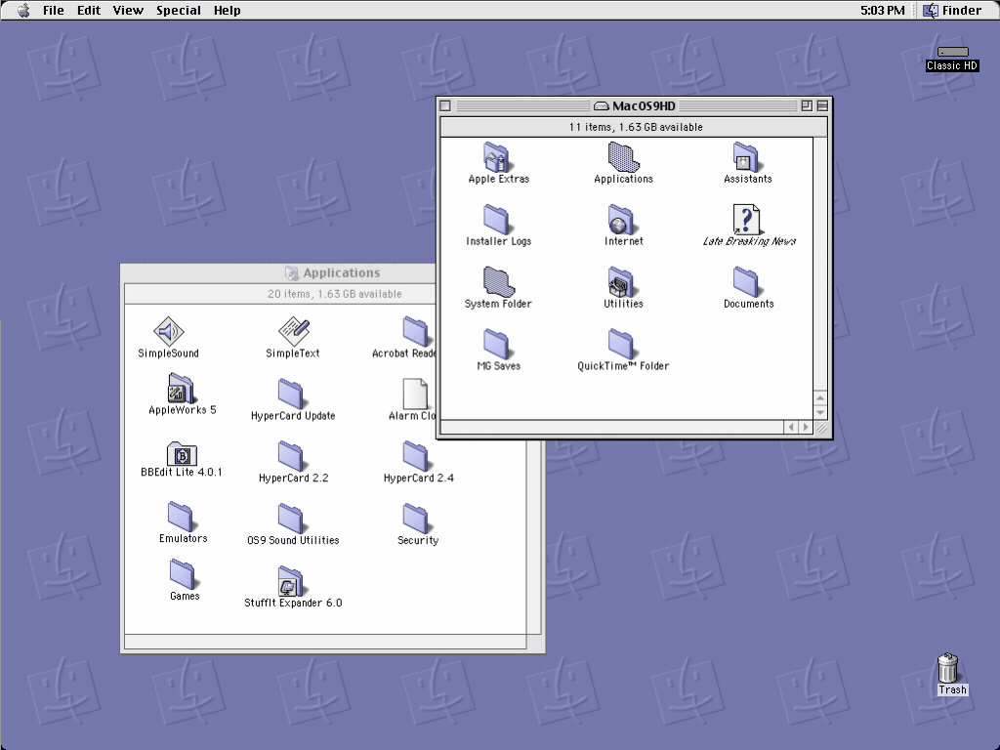

### Logo

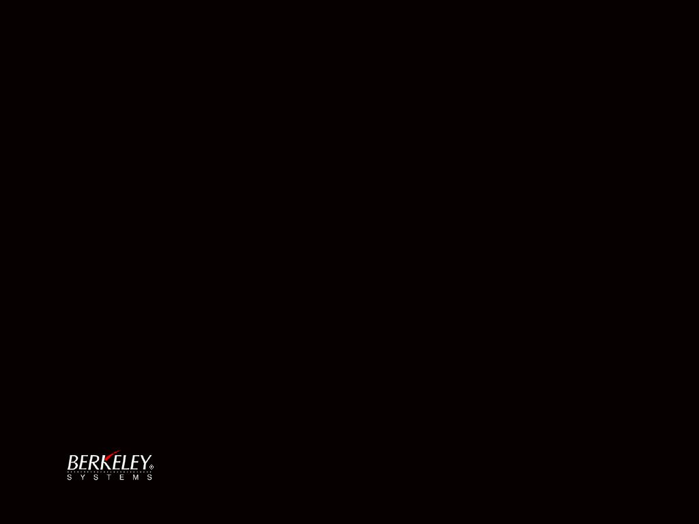

### Rainstorm

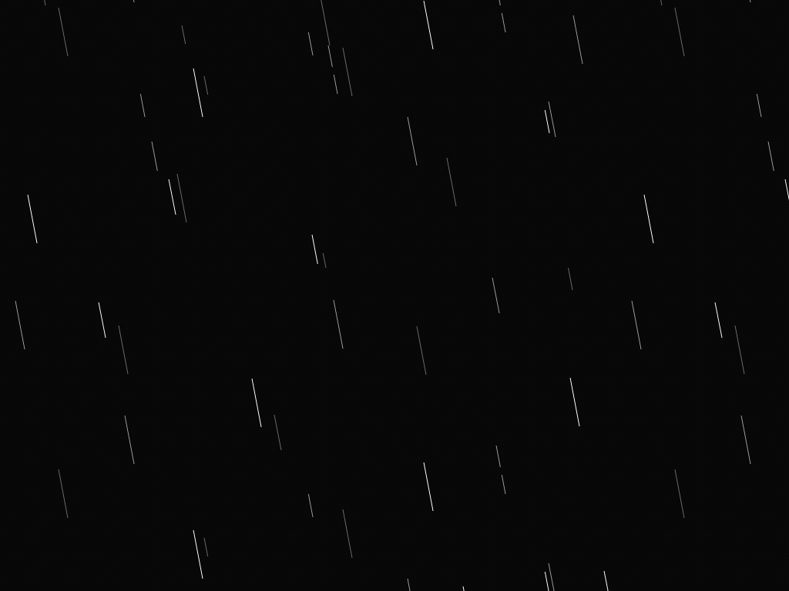

### Spotlight

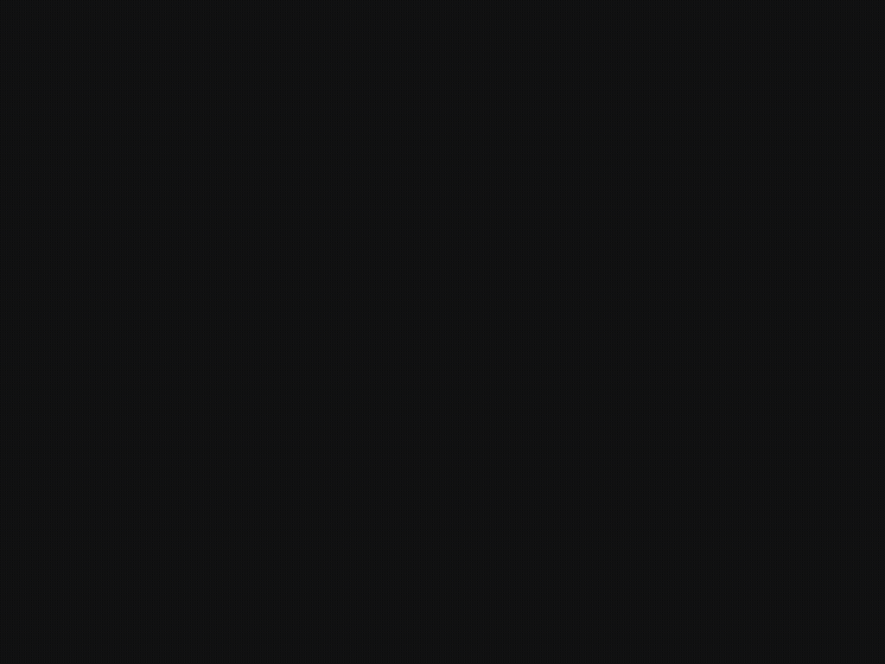

## Repository layout

```text
shared/      after-dark-css (submodule), page-presentation.js, asset validation
macos/       Xcode project, ScreenSaverView wrapper, and macOS test scripts
windows/     Win32 + WebView2 host, CMake project, and make.ps1
docs/        Gallery previews
```

Both hosts render the same pinned `after-dark-css` pages and apply the
**Object size** and **Motion speed** options with the same
`shared/page-presentation.js` script.

## Requirements

macOS:

- macOS 12 or later
- Xcode with the macOS SDK (building from source only)

Release builds are universal and run natively on both Apple silicon and Intel
Macs.

Windows:

- Windows 10 or 11 with the Microsoft Edge WebView2 Runtime (included with
  Windows 11)
- [Build Tools for Visual Studio 2026](https://visualstudio.microsoft.com/downloads/#build-tools-for-visual-studio-2026)
  with the **Desktop development with C++** workload (building from source only)

## Build and install on macOS

Clone with submodules, then build and verify the screen saver:

```sh
git clone --recurse-submodules https://github.com/dustywusty/slighty-after-dark.git
cd slighty-after-dark
make verify
```

Install it for the current user:

```sh
make install
```

Then select **Slightly After Dark** in System Settings under Wallpaper →
Screen Saver. You can also run `make open` to use macOS's normal screen saver
installer UI instead of copying it directly.

The verified build artifact is written to:

```text
Build/DerivedData/Build/Products/Release/Slightly After Dark.saver
```

To remove the locally installed copy, run `make uninstall`.

Local builds are ad-hoc signed for use on the Mac that built them. A public
download should be signed with a Developer ID certificate and notarized.

## Build and install on Windows

From PowerShell in a clone with submodules:

```powershell
.\windows\make.ps1 verify
.\windows\make.ps1 install
```

`install` copies the screen saver to
`%LOCALAPPDATA%\Programs\Slightly After Dark`, selects it, and opens Screen
Saver Settings. To remove it, run `.\windows\make.ps1 uninstall`.

The build is a single self-contained file:

```text
Build\windows\x64\Release\Slightly After Dark.scr
```

The assets are embedded in the `.scr`, so it can be copied anywhere on its own.
Right-click it and choose **Install** to select it without the script. Builds
target the host architecture by default; pass `-Architecture ARM64` or
`-Architecture x64` to choose one.

Unsigned builds may trigger a SmartScreen prompt on other PCs. A public
download should be Authenticode signed.

## Options

On macOS, open the screen saver's Options panel in System Settings. On
Windows, choose **Settings** in Screen Saver Settings. Either way you can tune
the animation:

- **Smoothness** (macOS only) runs the macOS 26 compatibility renderer from 15
  to 60 FPS (30 FPS by default). On the modern WebKit renderer, animations
  automatically follow the display refresh rate and this control is disabled.
  Windows always follows the display refresh rate.
- **Object size** scales foreground elements from 50% to 200% while preserving
  their crisp pixel-art rendering. Full-screen backgrounds and overlays stay at
  the display size.
- **Motion speed** changes the animation timeline from 50% to 200% independently
  of smoothness.
- **Show process memory usage** adds a once-per-second resident-memory readout
  to the upper-left corner. It is off by default. On Windows the readout is the
  combined working set of the screen saver and its WebView2 processes.

On macOS, changes preview immediately. **Done** saves them, while **Cancel**
restores the settings that were active when the panel opened. On Windows,
**OK** saves them to `HKCU\Software\Slightly After Dark`.

## Development

### macOS

The Xcode project lives in `macos/` and has a shared `slightly-after-dark`
scheme. Run these from the repository root:

```sh
make build             # Build a universal Release bundle
make verify            # Validate and load every saver through both renderers
make memory-test       # Measure compatibility renderer memory for 10 minutes
make clean
```

The animations live in the pinned `shared/after-dark-css` submodule. Builds enforce
that revision and validate every referenced runtime asset instead of silently
producing a blank screen saver. Run `make bootstrap` after updating an existing
checkout.

Gallery GIFs can be regenerated without recording the display:

```sh
make previews
```

The capture script uses the system WebKit renderer and requires `ffmpeg`.
If `gifsicle` is installed, it also performs an additional optimization pass.

The native wrapper uses `WKWebView`. macOS 26.4 introduced
[a system regression](https://developer.apple.com/forums/thread/820860) where
`WKWebView` content disappears inside legacy screen saver hierarchies. The issue
is still present through 26.6, so macOS 26.4 and later 26.x releases use a
compatibility renderer.

The workaround is intentionally limited to macOS 26. The compatibility
renderer disables accelerated compositing to prevent CoreAnimation memory growth
as its timer advances paused CSS animations. This uses a private WebKit preference
only when the runtime supports it. Each view has separate, unsaved preferences.

The affected host reports compatibility pages as hidden and freezes their CSS timeline.
The native screen saver timer advances cached animations at the configured frame rate.
Set `SAD_WEB_RENDERER=modern` or `SAD_WEB_RENDERER=legacy` when running a local
test harness to override that automatic choice.

The memory test runs Flying Toasters at 5120×1440 in a hidden window.
After a 30-second warmup, it measures the process memory footprint for ten minutes.
The test fails if growth exceeds 32 MiB.
It also checks that animations advance while the window is hidden.
This test does not replace an overnight test in the macOS screen saver host.

For a longer test, run `make memory-test MEMORY_TEST_SECONDS=3600`.
The `MEMORY_TEST_MAX_GROWTH_MIB` variable sets the permitted growth.

### Windows

The Windows host in `windows/` is a Win32 program that hosts WebView2. A
`.scr` is an ordinary executable that Windows launches with `/s` (full
screen), `/p <hwnd>` (the Settings preview), or `/c` (Options). Full-screen
mode opens one window per monitor and exits on a mouse move, click, or key
press.

The build fetches a pinned, hash-checked WebView2 SDK from NuGet. It links the
static WebView2 loader and the static C runtime. CMake embeds every file in
`shared/after-dark-css/{all,img,fonts}` as a resource, which WebView2 serves
from the reserved `https://slightly-after-dark.example` origin. Configuration
fails if a page or stylesheet references an asset that is missing. It also
fails if the submodule is checked out at a different revision than the one the
repository records.

`make.ps1 verify` runs the screen saver with `/verify`. This loads every saver
offscreen and applies 150% object size and 125% motion speed. It then checks
that the page finished loading, its CSS animations exist and run at the new
rate, and no asset request failed.

## Credits and asset licensing

Special thanks to [Bryan Braun](https://github.com/bryanbraun) for creating
[after-dark-css](https://github.com/bryanbraun/after-dark-css), whose HTML and
CSS power these animations.

Upstream documents the HTML/CSS as MIT-licensed and the ChicagoFLF font under
the SIL Open Font License. The original imagery is copyright Berkeley Systems;
review [upstream's licensing notes](https://github.com/bryanbraun/after-dark-css#license)
before redistributing a build.
